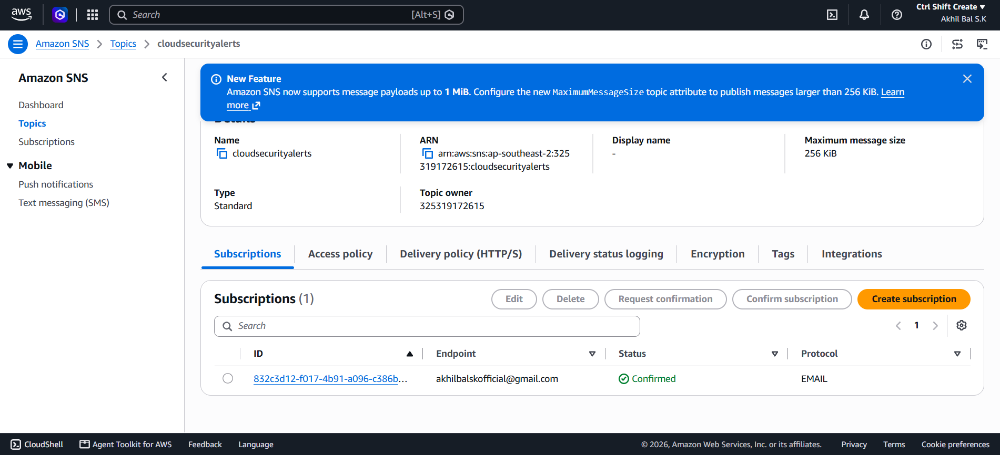
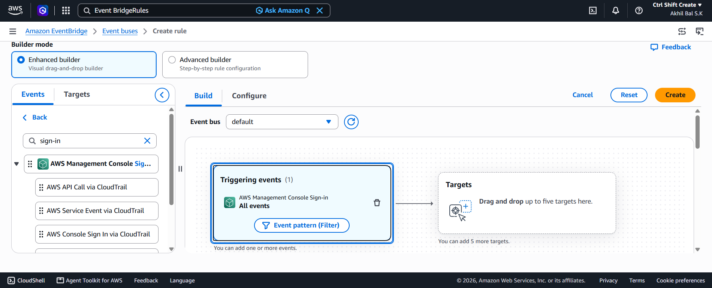
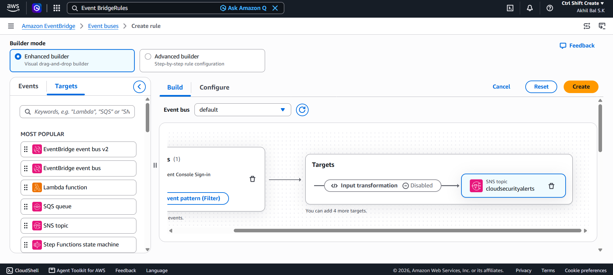
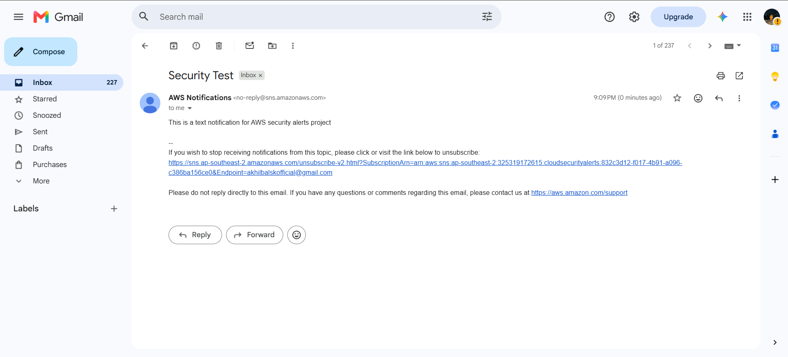

# AWS Event-Driven Cloud Security Alerting System

## 📌 Project Overview
This project establishes a real-time monitoring and alerting pipeline to track **AWS Management Console Sign-in events**. By leveraging cloud-native tools, the system automatically detects user logins and immediately dispatches an email notification to the security team. 

This architecture is critical for operational compliance, tracking administrative sessions, and detecting potential unauthorized or credential-compromised console access.

## 🏗️ Architecture Blueprint
The solution is built strictly using decoupled, serverless AWS services:
1. **Detection Engine:** **Amazon EventBridge** monitors the `default` event bus for `aws.signin` events matching `AWS Console Sign-in Sign-in Events`.
2. **Notification Engine:** **Amazon Simple Notification Service (SNS)** receives the filtered event data via a Standard Topic named `cloudsecurityalerts`.
3. **Delivery Mechanism:** **Email Subscription** instantly routes the security payload directly to the administrator's inbox upon confirmation.

## 🚀 Key Features
- **Zero Infrastructure Management:** Uses entirely serverless architecture with no servers to maintain or scale.
- **Real-Time Delivery:** Low-latency routing from console login to email dispatch.
- **Security-First Approach:** Implements a fundamental security baseline for monitoring administrative entry points.

## 🖼️ Implementation & Verification

### 1. Simple Notification Service (SNS) Configuration
An Amazon SNS Standard Topic named `cloudsecurityalerts` was provisioned. An email subscription endpoint was created and verified to ensure high-priority alert delivery availability.



### 2. EventBridge Rule Configuration
The EventBridge event pattern matches console logins globally across the AWS environment using the following JSON specification:

```json
{
  "source": ["aws.signin"],
  "detail-type": ["AWS Console Sign-in Sign-in Events"]
}
```



### 3. Asynchronous Target Attachment
The verified SNS topic was securely mapped as the downstream consumer target within the EventBridge canvas workflow.



### 4. Operational Proof-of-Concept Validation
Below is the verification email received immediately following a simulated AWS console administrative session authorization trigger:



## 🛠️ Next Steps / Future Enhancements
- Implement an **EventBridge Input Transformer** to parse and clean the raw JSON payload into a highly formatted, user-friendly security brief template.
- Add conditional logic to filter and alert *only* on specific risky actions, such as `Root` user logins or console credentials authenticating from unexpected public IP ranges.
- Transition the manual architecture deployment pipeline into declarative **Terraform Infrastructure as Code (IaCode)** files for multi-account deployment scaling.
